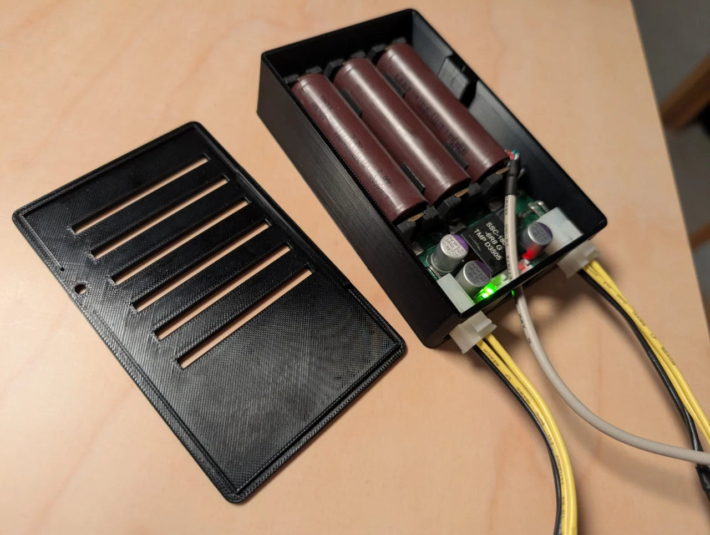
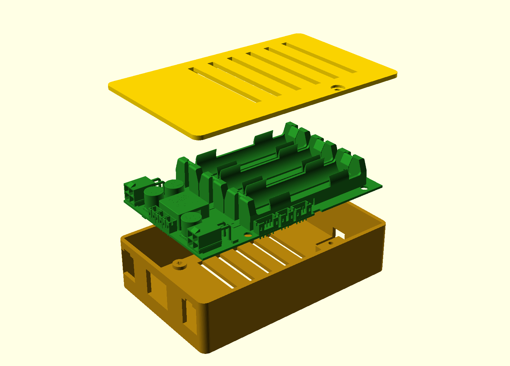

# OpenUPS2 enclosure — rev F

A two-part 3D printed case for the **Mini-Box OpenUPS2** (11–24 V DC-DC UPS,
3 × 18650 LiFePO4 board).





All dimensions come from Mini-Box's own mechanical data (in `vendor/`): the
dimensioned drawing gives 115.20 × 69.85, the 76.60 × 61.72 hole pitch and the
22.16 overall height, and the official STEP model was imported with CadQuery so
every connector, battery holder, mounting hole and below-board component could
be measured from solid geometry rather than guessed from photos.

*Originally generated by Hermes Agent + deepseek-v4.1-flash-1017.*

## Change history

**rev B** — after inspecting the real board:

1. The board has its own 4.5 mm screw offsets underneath, so the base lost its
   posts; screws go **up from underneath** into the board's own offsets.
2. Four top lid screws replaced by a **lip on the back edge that hooks into a
   groove** plus **one 6-32 UNC PC case screw** at the front.

**rev C:**

3. Four **2 mm pads** on the floor carry the board's offsets, lifting the PCB
   clear for the DIP switch.
4. The 2.5 mm feet were removed — flat bottom, for owner-supplied feet.

**rev D:**

5. Base **1 mm taller** for extra battery clearance.
6. The lid-screw boss bottom **raised 2 mm** off the PCB (it was flush with the
   PCB top and overlapping the board footprint — a real interference).
7. The cable hole in the **long side wall is gone**.
8. The **middle port** in the back wall is now a full 15 mm tall, matching the
   two molex ports either side, so cables can be pushed out through it.
9. **All three port openings lifted 2.5 mm.**
10. **Locking-latch notch** at the top centre of each of the two molex openings —
    6 mm wide, 1.5 mm deep.

**rev E:**

11. **DIP window inset removed** — the floor is a constant 2.4 mm thick around it.
12. Lid-screw boss bottom **raised a further 2 mm** (4 mm clear of the PCB) and the
    boss **thickened 1 mm**, so the 6-32 hole sits further from its free edge.

**rev F:**

13. **All five screw counterbores set to Ø7.50** so screws with wider heads seat
    fully — the four M3 board holes were Ø6.40 (now Ø7.50, 1.6 deep, underside),
    the lid's 6-32 hole was Ø7.00 (now Ø7.50, 1.3 deep). Clearance bores
    (Ø3.40 floor, Ø3.60 lid) are unchanged, so only the heads gained room.
    The lid recess now leaves 0.40 mm to the lid's front edge — one extrusion
    width, see Caveats.

## Files

| file                | what                                                                   |
| ------------------- | ---------------------------------------------------------------------- |
| `enclosure.scad`    | parametric source — edit the top block to change anything              |
| `base.stl`          | floor, pads, walls, three ports, DIP opening, hinge groove, screw boss |
| `lid.stl`           | vented lid with the hinge lip and a single 6-32 hole                   |
| `assembly.scad`     | exploded preview with the real board model inside                      |
| `board_in_case.stl` | the board (from Mini-Box's STEP) at case coordinates                   |
| `tools/verify.py`   | 54 point-containment checks on every opening and feature               |
| `tools/padcheck.py` | boolean check of the four pads against all 626 board parts             |
| `preview/`          | `asm.png` exploded view, `walls.png` four elevations                   |

## Print

* 0.4 mm nozzle, 0.2 mm layers
* 3 perimeters, 4 top / 4 bottom layers
* 15 % infill — the shell is thin-walled, so the walls come out solid anyway
* **no supports** — base floor-down, lid outside-up
* ~62 cm³ of material, roughly **78 g** of PLA/PETG

## Assembly

1. **Board:** drop it in, battery holders up, the three JST / mini-FIT
   connectors facing the port wall. Its four offsets land on the four pads.
2. **Board screws:** 4 × **M3 × 8** from underneath, through the counterbored
   floor holes and pads, into the board's offsets (~4.4 mm through floor + pad,
   3.6 mm of engagement).
3. **Lid:** hook the back edge in first — tip the lid so its lip drops behind
   the back wall, then lower the front. The lip's toe slides into the groove and
   stops the back lifting.
4. **One 6-32 UNC PC case screw** (6–8 mm) through the front of the lid into the
   boss. Done.

## Layout

```
        ┌─────────────────────────────────────────────┐
        │  P1 in    ┌──┐┌──┐┌──┐                      │  ← port wall (short)
        │  P2 out   │  ││  ││  │  (3 battery holders) │    3 openings, all
        │  P7/P9/P10└──┘└──┘└──┘                      │    15 mm tall, lifted
        │                                             │     2.5 mm
        └─────────────────────────────────────────────┘
                    long walls: solid
                                              ·P5·  ← DIP switch, underside
```

* **Port wall** (76.66 mm, three openings on one 15 mm band at z 9.00–24.00):
  P1 input and P2 output (4-pin mini-FIT JR) either side of a wide middle
  opening for P7 external LED, P9 relay, P10 start/stop (3 × JST PH).
  Each molex opening has a **6 × 1 mm latch notch** cut into the top centre for
  the plug's locking latch; the middle opening's top edge is flat.
* **Long walls**: both solid.
* **Right wall**: solid apart from the DIP notch at the bottom.

## Vents

* **Lid**: 6 slots (3.5 × 55 mm) directly over the three battery holders.
* **Floor**: 5 slots (3.5 × 50 mm) under the same area, so there is a through
  draught past the cells.

## The P5 DIP switch

The 3-way configuration switch is on the **underside**, about 3.8 mm in from the
right-hand edge. It sits 5.6 mm above the floor, giving **3.2 mm of clear
reach**, and the access is doubled up:

* a plain 10 × 10 mm **floor window**, straight through the 2.4 mm floor, for a
  small flat screwdriver from underneath;
* a **notch through the right-hand wall** up to the PCB underside, to come in
  sideways instead.

There is no inset or relief around the window — the floor is a constant 2.4 mm
there. (An earlier revision thinned it to 1.2 mm to buy reach, back when the
board sat flat on the floor and the switch cleared it by only 1.2 mm; the 2 mm
pads made that unnecessary.)

## Key numbers (mm)

|                                             |                                                                          |
| ------------------------------------------- | ------------------------------------------------------------------------ |
| board                                       | 115.20 × 69.86 × 1.20                                                    |
| mounting holes                              | 4 × Ø4.32 at (29.30, 4.07) (105.90, 4.07) (29.30, 65.78) (105.90, 65.78) |
| floor pads                                  | 4 × Ø8.0 × 2.0 high, Ø3.4 bore                                           |
| screw counterbores                          | all 5 × Ø7.50 — floor 1.60 deep (underside), lid 1.30 deep               |
| board's own offsets                         | 4.50 → PCB underside 8.90, PCB top 10.10                                 |
| tallest part                                | +15.01 above PCB top → 25.11                                             |
| deepest part                                | −4.50 below PCB top → 5.60                                               |
| port band                                   | z 9.00 – 24.00 (15.0 tall, 2.5 lift applied)                             |
| molex latch notch                           | 6.00 wide × 1.50 deep, top centre of P1 and P2 openings                  |
| wall above the notch                        | 3.90                                                                     |
| outside                                     | 122.00 × 76.66 × 29.40 (31.60 with the lid)                              |
| inside                                      | 117.20 × 71.86 × 29.40                                                   |
| floor / wall / lid                          | 2.40 / 2.40 / 2.20                                                       |
| corner radius                               | 4.00                                                                     |
| **battery clearance** (board top → lid rib) | **3.19**                                                                 |
| boss bottom → PCB top                       | **4.00**                                                                 |
| board top → hinge lip bottom                | 0.89                                                                     |
| DIP switch → floor                          | 3.20                                                                     |
| hinge groove                                | x 30–92, z 25.60–27.40, 1.30 deep into the back wall                     |
| 6-32 pilot                                  | Ø2.75 × 8 deep, boss x 76–92, y 2.40–6.90, z 14.10–29.40                 |

## Changing things

Named constants at the top of `enclosure.scad`:

* `BOARD_OFF` — height of the board's own screw offsets. **Worth a caliper
  check.** Taller is safe; shorter eats the DIP clearance.
* `PAD_H` — pad height; lifts the board and the case together.
* `WALL_H` — overall height. Hinge groove (z 25.6–27.4) must stay above the
  board top (25.11) and below the lid plate.
* `BOSS_CLR`, `BOSS_Y1` — lid-screw boss: gap above the PCB, and how far it
  stands into the case.
* `PORT_LIFT`, `PORT_H`, `PORT_Z0` — the three port openings. All three use the
  same band, so the wall stays coherent.
* `HINGE_X0/X1`, `GR_Z0/Z1`, `GR_DEPTH` — hinge.
* `BOSS_X0/X1`, `SCREW_X` — lid screw position.
* `SCR_CB_D`, `LID_CB_D` — the five head insets (all Ø7.50). Widen these, not
  `SCR_D`/`LID_HOLE_D`, when a screw head does not seat.
* `DIP_X0/X1`, `DIP_Y0/Y1` — DIP window.
* `part` — `"base"`, `"lid"`, `"both"` or `"none"`.

```sh
openscad -o base.stl -D 'part="base"' enclosure.scad
openscad -o lid.stl  -D 'part="lid"'  enclosure.scad
```

## Checks that were run

`tools/verify.py` — **57/57 pass**. Points inside every intended void and solid:
four pads and bores, all five counterbores (each probed inside *and* outside
Ø7.50, so the size is pinned rather than merely "a hole"), the three 15 mm ports
including a probe at
z 21.5 that proves the middle opening is now full height, both long walls now
solid, the DIP window at both floor faces (proving there is no inset) and the
wall notch, both vent patterns, the
hinge groove and end stops, the lip and toe, the boss (4 mm clear at z 13.0,
solid at 12.6, solid at y 6.6 and void at y 7.4 — pinning the new height and
the new thickness), the 6-32 pilot and the rib notch. The latch notches are pinned
down four ways each: void at the centre, solid 4 mm off centre (so it really is
6 mm wide), solid 1.9 mm above the opening top (so it really is 1.5 mm deep),
and absent on the middle opening.

`tools/padcheck.py` — the four Ø8 pads boolean-intersected with all 626 board
components: clear on all four.

Board envelope 3.40–118.60 × 3.40–73.26 × 5.60–25.11 sits inside the cavity
2.40–119.60 × 2.40–74.26 × 2.40–29.40, with 1.0 mm on all four sides.

## Caveats

* **The lid counterbore sits close to the lid's front edge.** Ø7.50 centred on
  y 4.15 leaves 0.40 mm of lid between the recess and the front face — exactly one
  0.4 mm extrusion, so the rim prints as a single perimeter rather than a wall.
  It holds (the head bears on the recess floor, and the front wall underneath is
  untouched), but it is the minimum; going beyond Ø7.5 there starts to break out.
  A closed, chunky rim would need the screw moved back, which means growing
  `BOSS_Y1` as well.
* **The three front-edge connectors (P3 USB, P6 power-sw, P8 SMBUS) can no
  longer be mated.** Their bodies sit at enclosure y 3.45–7.95 facing the long
  wall, whose inside face is at y 2.40 — i.e. 1.05 mm away. With that wall now
  solid there is no path for a plug, and the 1.0 mm board-to-wall gap is far too
  narrow to route their cables round to the port wall. If you want those three
  in use, that wall needs an opening again (or a routing slot at one end).
* Mini-Box's STEP is the 2015 revision and does not name P5; the switch position
  was matched against Mini-Box's own bottom-side photo, calibrated on the four
  mounting holes (4.41 px/mm, 0.26 % agreement between axes).
* That STEP models the under-board offsets as 6.03 mm tall; rev D uses the
  4.5 mm measured. `padcheck.py` ignores those modelled offsets deliberately.
* Port openings keep the connector width + 1–1.5 mm; width was unchanged by
  rev D, only the height and the 2.5 mm lift.
* The latch notch assumes the plug's latch is on the **top** face. If your
  mini-FIT plugs latch downward, flip `MOLEX_NOTCH_W`/`MOLEX_NOTCH_H` to the
  bottom edge instead — it is one line in the `for (yc = ...)` block.
